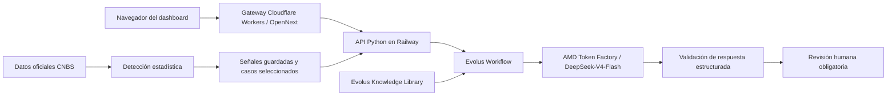

# Actuarial Signal Radar

[English](README.md) · [Índice documental](docs/README.md) · [Guía para jueces](docs/judges-guide.es.md)

**Primero detectamos. Luego la IA investiga. La persona decide.**

Sistema de investigación de alerta temprana para seguros, desarrollado para **AMD Developer Hackathon: ACT III**. Usa datos oficiales de CNBS Honduras para detectar desviaciones inusuales en seguros de vehículos y organizar una investigación con evidencia para un actuario. No establece causas ni predice desastres.

## El problema

Un cambio emergente puede hacerse evidente en reportes agregados de seguros cuando ya es grande. El proyecto identifica meses que merecen atención frente a una referencia histórica interpretable. Es exploración retrospectiva de señales, no rendimiento predictivo futuro demostrado.

Alcance principal: **Seguros Generales / Vehículos Automotores / CodMoneda 1 / Nacional**. Primas y Siniestros son agregados contables mensuales, no siniestros individuales. El snapshot descargado el 2026-10-03 cubre enero de 2018–agosto de 2026, con 104 fechas reportadas. El corte de disponibilidad admite 103 períodos hasta julio de 2026.

## Por qué detectamos con estadística y no con ML complejo

Alrededor de 100 meses por serie constituyen una muestra temporal pequeña. Un modelo complejo podría sobreajustarse. Elegimos deliberadamente una referencia interpretable, reproducible y que mantenga visibles los problemas contables:

1. Estimar tendencia y estacionalidad por mes usando solo historia previa disponible.
2. Comparar **observado** con **esperado**: `residual = observed - expected`.
3. Detectar desviaciones con **z-score robusto de residuales y ventana de 12 meses** como referencia principal. Z-score estándar, EWMA y CUSUM bilateral aportan evidencia complementaria.
4. Conservar señales brutas, magnitud económica, persistencia, banderas de calidad y sensibilidades de cohortes/ajustes negativos.

No se implementó un detector ML. Con datos individuales más ricos se podrían comparar modelos ML frente a esta línea base; no necesariamente serían mejores. Un z-score robusto no es una probabilidad. La materialidad económica se evalúa por separado y es exploratoria.

## Dónde entra la IA

| Estadística | Investigación con IA | Persona |
|---|---|---|
| Esperado, residual, scores y NORMAL / WATCH / ALERT | Resumir evidencia, proponer hipótesis no establecidas, identificar información faltante y recomendar comprobaciones | Validar contexto, evaluar hipótesis y decidir |

El LLM recibe una señal ya detectada en un paquete inmutable. No puede cambiar valores ni clasificaciones. Toda respuesta aceptada exige **HUMAN_REVIEW_REQUIRED**; las explicaciones posibles son **HIPÓTESIS — NO ESTABLECIDA**.

## Arquitectura y despliegue



Cloudflare publica el frontend y el gateway del servidor. Railway ejecuta la API Python y lee resultados guardados; no recalcula estadísticas para la UI. Un token compartido del servidor protege `/api/*` en Railway; `/health` es público. El gateway agrega el token del lado del servidor. Los secretos nunca llegan a JavaScript del navegador. El despliegue no necesita base de datos, KV, R2 ni GPU Droplet.

## Evolus

- **Workspace:** Actuarial Signal Radar
- **Knowledge Library:** ActuarialSignalRadarMemory1
- **Workflow:** Actuarial Signal Investigation

Evolus coordina la entrega de señales validadas, el contexto documental curado, la ejecución del modelo, la validación estructurada y la revisión humana obligatoria. Por caso se recuperan seis documentos indexados relevantes y se verifican sus hashes. La búsqueda semántica nativa **no está validada independientemente**. Los lectores públicos no necesitan los IDs internos. [Configuración y contratos](evolus/README.md).

## AMD

El acceso a modelos del hackathon se proporciona mediante **AMD Token Factory**. Las investigaciones verificadas utilizaron **DeepSeek-V4-Flash**, mediante un **endpoint Chat Completions compatible con OpenAI**.

Se evaluó Qwen, incluidas pruebas pequeñas de JSON. DeepSeek-V4-Flash se eligió porque completó investigaciones estructuradas con mayor fiabilidad en el workflow y contexto probados. Es una observación limitada del proyecto, no un benchmark general ni una garantía: un reintento reciente de la razón también falló con DeepSeek en la validación estructurada.

Esta integración no requiere créditos de AMD Developer Cloud ni GPU Droplets propios. **No se validó ROCm/vLLM autohospedado.** [Integración AMD, contrato API y referencias](amd/README.md). Nunca se publican tokens, cabeceras secretas ni credenciales privadas.

## Casos FLAGSHIP

Los valores se redondearon para presentación a partir de paquetes inmutables existentes en `data/processed/investigations/`; no se recalcularon detectores. Se enlazan los informes de evidencia porque los datos procesados están ignorados por Git.

<!-- Formato de presentación de los paquetes de señales inmutables existentes. -->
| Medida | Septiembre de 2025 — siniestros del mercado | Marzo de 2025 — razón siniestros/primas |
|---|---|---|
| Período reportado | 2025-09-30 | 2025-03-31 |
| Disponibilidad simulada | 2025-12-01 | 2025-06-01 |
| Observado | ~L185.4 M | ~63.91% |
| Esperado | ~L142.4 M | ~53.05% |
| Diferencia | ~+L42.9 M | +10.86 puntos porcentuales |
| Diferencia relativa | ~30.15% | Ver informe del caso |
| Z robusto residual | 11.02 | 8.61 |
| Bruta → ajustada | ALERT → ALERT | NORMAL → ALERT |
| Materialidad exploratoria | HIGH | MEDIUM |

**Siniestros:** aproximadamente L42.9 millones por encima de lo esperado. **Razón:** el ajuste por tendencia y estacionalidad reveló una señal ausente en la clasificación bruta. Ningún caso establece causa ni persistencia futura. `claims_to_premiums_ratio` **no es una razón de pérdidas actuarial validada**.

[Caso de siniestros](reports/case-studies/market_claims_2025_09.es.md) · [Caso de la razón](reports/case-studies/market_ratio_2025_03.es.md) · [Selección de casos](docs/case-study-selection-methodology.md)

## Noviembre de 2020: un pico grande no es automáticamente ALERT

Noviembre de 2020 tenía observado, esperado y un residual grande, pero permaneció **UNSCORED**: todavía no había suficiente historia previa de residuales para calcular el detector robust-z. No se reclasificó manualmente.

**Sin marcador ≠ NORMAL.** El sistema requiere evidencia suficiente antes de clasificar. El primer período primario puntuado es 2021-10-31, con disponibilidad simulada 2022-01-01. [Valores exactos y estado de calibración](reports/dashboard/phase52-validation.md).

## Demo en vivo

**https://actuarial-signal-radar.diegoturciostc.workers.dev**

1. Abrir Panorama; español es el idioma predeterminado y se puede cambiar a inglés.
2. Elegir **Por año → 2025** y **Siniestros mensuales**.
3. Abrir el FLAGSHIP de septiembre de 2025.
4. Comparar observado con esperado y revisar la diferencia **+L42.9 M**.
5. Abrir la investigación con IA para observar **estadística → Evolus → AMD → revisión humana**.
6. Abrir marzo de 2025 y comparar **RAW NORMAL → ADJUSTED ALERT**.

Abrir una página no ejecuta inferencia. Pueden mostrarse resultados completos reales guardados, identificados explícitamente, para evitar inferencias repetidas innecesarias. Esto depende de la configuración: los trabajos de producción son temporales y pueden desaparecer tras un reinicio de Railway por inactividad. La acción explícita Investigar puede consumir la asignación del evento y fallar validación; nunca se inventan hallazgos.

## Estado del proyecto

| Componente | Estado |
|---|---|
| Preparación y procedencia de datos | Completa |
| Semántica | Completa para Automobile/Nacional; persisten salvedades contables |
| Línea base estadística | Completa |
| Comportamiento esperado | Completo |
| Validación de casos | Completa |
| Integración Evolus | Verificada en ejecuciones registradas |
| AMD Token Factory | Verificado en ejecuciones registradas |
| Dashboard | Verificado |
| Backend Railway | Verificado |
| Frontend Cloudflare | Verificado |
| Demo pública | Lista para el recorrido analítico; revisar las salvedades de investigación |
| Extremo a extremo, últimas pruebas públicas nuevas | **PARTIAL / VERIFIED FOR CLAIMS CASE** |

Las validaciones anteriores en local/Railway completaron ambos FLAGSHIP. La última investigación pública nueva de siniestros completó en **154.224 segundos**, con seis documentos, cero incidencias, valores intactos y revisión humana obligatoria. La primera investigación pública nueva de la razón activó una advertencia conservadora; un reintento revisado falló el paso Evolus `Validate structured AMD response` con **`Missing model execution envelope`**. Los controles **no se debilitaron** para aprobar ninguno de esos resultados. No deben confundirse pruebas anteriores con las más recientes. [Resultados de producción](docs/cloudflare-deployment.md) · [Verificación anterior](reports/investigations/token-factory/validation.md).

## Ejecutar localmente

Con Docker iniciado y los artefactos analíticos necesarios presentes:

```sh
docker compose up --build
```

Abrir **http://localhost:3000**. Un clon nuevo no incluye `data/raw/` ni `data/processed/`; primero debe ejecutarse el pipeline siguiente. Una nueva descarga de CNBS puede diferir del snapshot desplegado. No hacen falta credenciales de modelos para consultar las vistas analíticas generadas.

Para investigación real se configura un `.env` privado local usando [.env.example](.env.example). Los **nombres** requeridos dependen de la ruta elegida:

| Uso | Nombres |
|---|---|
| Selección de investigación | `INVESTIGATION_PROVIDER`, `INVESTIGATION_LANGUAGE` |
| Evolus | `EVOLUS_BASE_URL` / `EVOLUS_API_URL`, `EVOLUS_APPLICATION_ID` / `EVOLUS_WORKSPACE_ID`, `EVOLUS_API_KEY`, `EVOLUS_WORKFLOW_ID`, `EVOLUS_LIBRARY_ID`, `EVOLUS_RESULT_POINTER` |
| Pruebas directas Token Factory / configuración de modelo | `AMD_TOKEN_FACTORY_BASE_URL`, `AMD_TOKEN_FACTORY_MODEL`, `AMD_TOKEN_FACTORY_API_KEY` |
| Gateway alojado | `PUBLIC_BACKEND_URL`, `DASHBOARD_BACKEND_TOKEN` |

Evolus conserva la conexión del modelo del workflow real. No debe copiarse innecesariamente su credencial AMD a Railway o Cloudflare. Los procedimientos de cada servicio detallan opciones de polling y ejecución. No subir `.env` ni pasar secretos mediante `NEXT_PUBLIC_*`.

## Ejecutar el pipeline completo

Desde la raíz de un clon nuevo, estos comandos generan artefactos locales. Son innecesarios para recorrer la demo pública y no ejecutan inferencia de IA:

```sh
docker compose build
docker compose run --rm app python scripts/download_cnbs.py
docker compose run --rm app python scripts/profile_cnbs.py
docker compose run --rm app python scripts/prepare_cnbs.py
docker compose run --rm app python scripts/fetch_cnbs_semantics_evidence.py
docker compose run --rm app python scripts/derive_cnbs_monthly.py
docker compose run --rm app python scripts/run_statistical_backtest.py
docker compose run --rm app python scripts/run_expected_behavior_backtest.py
docker compose run --rm app python scripts/generate_case_studies.py
docker compose run --rm app python scripts/build_investigation_package.py --case market_claims_2025_09
docker compose run --rm app python scripts/build_investigation_package.py --case market_ratio_2025_03
docker compose up --build
```

Reproducen el proceso, no necesariamente el snapshot ni las señales originales tras revisiones de la fuente. [Referencia detallada de CNBS y preparación](docs/data-foundation-reference.md).

## Consideraciones de seguridad

- Las API keys y `.env` privados no se incluyen en Git; los secretos usan bindings y configuración del servidor.
- Railway exige el token compartido en `/api/*`; el navegador no recibe ese token ni credenciales Evolus/AMD.
- Se investigan paquetes inmutables cargados por el servidor; el navegador no puede reemplazar valores analíticos.
- Cada resultado exige revisión humana. Las afirmaciones causales definitivas sin respaldo se rechazan o marcan para revisión; aprobar controles automáticos no demuestra verdad narrativa.
- La demo supervisada valida el origen de POST, pero no tiene una puerta de autenticación de presentador ni rate limit global duradero.

## Limitaciones

1. **Validez histórica estricta point-in-time: NOT VALIDATED.** Es un **LAGGED RETROSPECTIVE BACKTEST** sobre el snapshot histórico actual.
2. El **rezago conservador de dos meses** es un supuesto calendario: enero se considera disponible el 1 de abril. No es el calendario confirmado de CNBS ni sumar exactamente 60 días.
3. El snapshot puede incorporar revisiones posteriores; no se reconstruyeron versiones y fechas históricas de publicación.
4. Los agregados contables mensuales limitan la granularidad. Persisten dudas sobre pagos/incurridos, reservas y reaseguro.
5. Las bandas de materialidad son exploratorias, no umbrales regulatorios ni de capital.
6. La búsqueda semántica nativa de Evolus no está validada independientemente; el contexto indexado se verifica mediante hashes.
7. No se validó ROCm/vLLM autohospedado; se utiliza AMD Token Factory.
8. Los trabajos temporales de Railway pueden desaparecer al reiniciar por inactividad.
9. El último reintento público de la razón de marzo falló con **`Missing model execution envelope`**. La primera respuesta también activó una advertencia conservadora de lenguaje. No se debilitaron controles.
10. No se actualizó el plan de Cloudflare. OAuth no permitió confirmar independientemente su nivel de facturación; el funcionamiento observado no garantiza margen de CPU en Free.

## Documentación, validación y atribución

Consultar el [índice documental](docs/README.md) o la [guía para jueces](docs/judges-guide.es.md). Allí se enlazan fórmulas, umbrales, semántica, casos, despliegue e informes de validación.

```sh
docker compose run --rm app pytest
cd frontend
npm test
npm run typecheck
RUN_LIVE_VALIDATION=1 npx playwright test
```

El último comando consulta informes de modelos guardados y validados localmente; no inicia inferencias nuevas. Las pruebas que dependen de datos requieren los artefactos locales. Última suite registrada: **313 pruebas backend, 25 frontend, 16 de navegador local y ocho del gateway**, TypeScript, Docker y OpenNext. Esos resultados no sustituyen la prueba pública parcial de la razón.

Datos: **CNBS Honduras**. Infraestructura y servicios: **Cloudflare**, **Railway**, **Evolus** y **AMD Token Factory**. Modelo instruct: **DeepSeek-V4-Flash**; Qwen se evaluó como comparación. Los procedimientos de cada servicio incluyen referencias oficiales y deben respetarse sus términos externos.

**Licencia del repositorio:** no se ha elegido un archivo LICENSE. Este README no inventa ni concede una licencia; publicar código no equivale por sí solo a otorgar una licencia de software.
