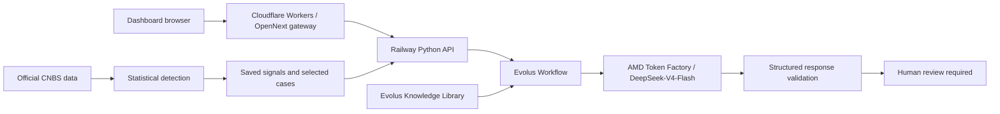

# Actuarial Signal Radar

[Español](README.es.md) · [Documentation index](docs/README.md) · [Judge's guide](docs/judges-guide.md)

**We detect first. AI investigates second. Humans decide.**

An insurance early-warning research system for **AMD Developer Hackathon: ACT III**. It uses official CNBS Honduras data to detect unusual deviations from expected motor-insurance behavior, then organizes an evidence-aware investigation for an actuary. It does not establish causes or predict disasters.

## The problem

Emerging changes can become obvious in aggregate insurance reports only once they are large. The project asks which monthly changes deserve earlier attention relative to an interpretable historical reference. This is retrospective signal exploration, not demonstrated prospective warning performance.

Primary scope: **Seguros Generales / Vehículos Automotores / CodMoneda 1 / Nacional**. Primas and Siniestros are monthly accounting aggregates, not individual claims. The source snapshot downloaded on 2026-10-03 spans January 2018–August 2026 (104 reporting dates). The saved replay admits 103 periods through July 2026 under its availability cutoff.

## Why statistics, rather than complex ML, detects the signal

Around 100 monthly observations per main series are a small temporal sample. Complex models can overfit it. We deliberately use an interpretable, reproducible baseline that keeps accounting-quality issues visible:

1. Estimate trailing trend and month-of-year seasonality using only prior available observations.
2. Compare **observed** with **expected**; `residual = observed - expected`.
3. Detect unusual residuals with a **12-month robust z-score** as the primary reference. Standard z-score, EWMA and two-sided CUSUM provide complementary evidence.
4. Keep raw signals, economic magnitude, persistence, quality flags and cohort/negative-adjustment sensitivities visible.

No ML anomaly detector is implemented. With richer individual claim/policy data, ML could be benchmarked against this baseline; greater complexity would not automatically be better. A robust z-score is not a probability. Economic materiality is separate and exploratory.

## Where AI belongs

| Statistics | AI investigation | Human |
|---|---|---|
| Expected value, residual, scores and NORMAL / WATCH / ALERT | Summarize evidence, propose unestablished hypotheses, identify missing information and recommend checks | Validate context, evaluate hypotheses and decide |

The LLM receives an already-detected, immutable signal package. It cannot change analytical values or classifications. Every accepted result requires **HUMAN_REVIEW_REQUIRED**; hypotheses are **HYPOTHESIS — NOT ESTABLISHED**.

## Architecture and deployment



Cloudflare serves the public frontend and server-side gateway. Railway runs the existing Python API and reads saved analytical artifacts; it does not recalculate statistics for the UI. A server-side shared token protects Railway `/api/*`; `/health` is public. The gateway attaches the token on the server. Secrets never enter browser JavaScript. No database, KV, R2 or GPU Droplet is required by this deployment.

## Evolus

- **Workspace:** Actuarial Signal Radar
- **Knowledge Library:** ActuarialSignalRadarMemory1
- **Workflow:** Actuarial Signal Investigation

Evolus orchestrates validated signal handoff, curated knowledge context, model execution, structured-response validation and the human-review requirement. Six relevant indexed documents are retrieved and checksum-verified per case. Native semantic-search execution is **not independently validated**. Public readers do not need internal workspace/library/workflow IDs. [Setup and contracts](evolus/README.md).

## AMD

Hackathon model access is provided through **AMD Token Factory**. The verified investigation runs used **DeepSeek-V4-Flash**, via an **OpenAI-compatible Chat Completions endpoint**.

Qwen was evaluated, including small JSON tests. DeepSeek-V4-Flash was selected because it completed structured investigations more reliably in the tested full-context workflow. This is a limited project observation, not a general model benchmark or a guarantee; a recent DeepSeek ratio retry also failed structured-response validation.

AMD Developer Cloud credits and self-provisioned GPU droplets are not required for this integration. **Self-hosted ROCm/vLLM is not validated.** [AMD integration, API contract and service references](amd/README.md). Tokens, authentication headers and private credentials are never published.

## FLAGSHIP cases

The values below are rounded for display from existing immutable packages in local `data/processed/investigations/`; they are not recalculated detector results. Source-backed case reports are linked because processed data are Git-ignored.

<!-- Display-only formatting from existing immutable signal packages. -->
| Measure | September 2025 — market claims | March 2025 — claims-to-premiums ratio |
|---|---|---|
| Report period | 2025-09-30 | 2025-03-31 |
| Simulated availability | 2025-12-01 | 2025-06-01 |
| Observed | ~L185.4M | ~63.91% |
| Expected | ~L142.4M | ~53.05% |
| Difference | ~+L42.9M | +10.86 percentage points |
| Relative difference | ~30.15% | See saved case report |
| Residual robust z | 11.02 | 8.61 |
| Raw → adjusted | ALERT → ALERT | NORMAL → ALERT |
| Exploratory materiality | HIGH | MEDIUM |

**Claims:** approximately L42.9M above expected. **Ratio:** trend/seasonality adjustment revealed a signal absent from the raw classification. Neither case establishes cause or future persistence. `claims_to_premiums_ratio` is **not a validated actuarial loss ratio**.

[Claims case](reports/case-studies/market_claims_2025_09.md) · [Ratio case](reports/case-studies/market_ratio_2025_03.md) · [Selection methodology](docs/case-study-selection-methodology.md)

## November 2020: a large spike is not automatically an ALERT

November 2020 had observed data, an expected value and a large residual, but remained **UNSCORED** because there was insufficient prior residual history to calculate the robust-z detector. No manual reclassification was applied.

**No marker ≠ NORMAL.** The system requires sufficient evidence before classifying. The first scored primary report period is 2021-10-31 (simulated availability 2022-01-01). [Exact saved values and warm-up status](reports/dashboard/phase52-validation.md).

## Live Demo

**https://actuarial-signal-radar.diegoturciostc.workers.dev**

1. Open Overview; Spanish is the default and English is available.
2. Select **By year → 2025** and **Monthly claims**.
3. Open the September 2025 FLAGSHIP.
4. Compare observed with expected and review the **+L42.9M** difference.
5. Open the AI investigation panel to inspect **statistics → Evolus → AMD → human review**.
6. Open March 2025 to compare **RAW NORMAL → ADJUSTED ALERT**.

Opening a page does not start inference. Saved completed real investigation results may be shown, explicitly labeled, to avoid unnecessary repeat inference. Their availability depends on runtime configuration: production jobs are transient and can disappear after a Railway idle restart. An explicit Investigate action can consume event allowance and may fail validation; no findings are fabricated.

## Project status

| Component | Status |
|---|---|
| Data Foundation | Complete |
| Semantics | Complete for Automobile/Nacional; accounting caveats remain |
| Statistical Baseline | Complete |
| Expected Behavior | Complete |
| Case Validation | Complete |
| Evolus Integration | Verified in recorded integration runs |
| AMD Token Factory | Verified in recorded integration runs |
| Dashboard | Verified |
| Railway Backend | Verified |
| Cloudflare Frontend | Verified |
| Public Demo | Ready for analytical walkthrough; live investigation caveats below |
| Production end-to-end, latest fresh public tests | **PARTIAL / VERIFIED FOR CLAIMS CASE** |

Earlier local/Railway validations completed both FLAGSHIPs. The latest fresh public claims run completed in **154.224 seconds**, with six knowledge documents, zero validation issues, unchanged values and human review required. The latest fresh public ratio run returned a conservative validation warning; one reviewed retry then failed the Evolus step `Validate structured AMD response` with **`Missing model execution envelope`**. The safeguards were **not weakened** to bypass either outcome. These earlier and latest results must not be conflated. [Production outcomes](docs/cloudflare-deployment.md) · [Earlier investigation verification](reports/investigations/token-factory/validation.md).

## Run locally

With Docker running and the required analytical artifacts present:

```sh
docker compose up --build
```

Open **http://localhost:3000**. A fresh clone does not include `data/raw/` or `data/processed/`; use the pipeline below first. Downloading CNBS again may produce a different snapshot from the deployed demo. No model credentials are needed to inspect generated analytical views.

For live investigation, configure a private local `.env` using [.env.example](.env.example). Required variable **names** depend on the selected path:

| Purpose | Names |
|---|---|
| Investigation selection | `INVESTIGATION_PROVIDER`, `INVESTIGATION_LANGUAGE` |
| Evolus | `EVOLUS_BASE_URL` / `EVOLUS_API_URL`, `EVOLUS_APPLICATION_ID` / `EVOLUS_WORKSPACE_ID`, `EVOLUS_API_KEY`, `EVOLUS_WORKFLOW_ID`, `EVOLUS_LIBRARY_ID`, `EVOLUS_RESULT_POINTER` |
| Direct Token Factory checks / model configuration | `AMD_TOKEN_FACTORY_BASE_URL`, `AMD_TOKEN_FACTORY_MODEL`, `AMD_TOKEN_FACTORY_API_KEY` |
| Hosted gateway | `PUBLIC_BACKEND_URL`, `DASHBOARD_BACKEND_TOKEN` |

Evolus owns the live workflow's model connection. Do not unnecessarily copy its AMD credential into Railway or Cloudflare. Detailed polling/runtime options remain in the service runbooks. Do not commit `.env` or pass secrets through `NEXT_PUBLIC_*`.

## Run the complete pipeline

For a new local checkout, run these from the repository root. They generate local artifacts and are unnecessary for viewing the public demo. They do not run AI inference:

```sh
docker compose build
docker compose run --rm app python scripts/download_cnbs.py
docker compose run --rm app python scripts/profile_cnbs.py
docker compose run --rm app python scripts/prepare_cnbs.py
docker compose run --rm app python scripts/fetch_cnbs_semantics_evidence.py
docker compose run --rm app python scripts/derive_cnbs_monthly.py
docker compose run --rm app python scripts/run_statistical_backtest.py
docker compose run --rm app python scripts/run_expected_behavior_backtest.py
docker compose run --rm app python scripts/generate_case_studies.py
docker compose run --rm app python scripts/build_investigation_package.py --case market_claims_2025_09
docker compose run --rm app python scripts/build_investigation_package.py --case market_ratio_2025_03
docker compose up --build
```

These commands reproduce the process, not necessarily the original snapshot or identical signals after source revisions. [Detailed CNBS/data foundation reference](docs/data-foundation-reference.md).

## Security considerations

- API keys and private `.env` files are not committed; runtime secrets use server-side bindings/configuration.
- Railway `/api/*` requires the shared backend token; the browser never receives it or Evolus/AMD credentials.
- Only immutable, server-loaded case packages are investigated; the browser cannot supply replacement analytical values.
- Every result requires human review. Unsupported definitive causal language is rejected or flagged; passing automated checks is not proof of narrative truth.
- The supervised demo has same-origin POST checks, not a presenter-authentication gate or durable global rate limit.

## Limitations

1. **Strict historical point-in-time validity: NOT VALIDATED.** This is a **LAGGED RETROSPECTIVE BACKTEST** using the current historical snapshot.
2. The **conservative two-month reporting lag** is a calendar assumption: January month-end becomes available April 1. It is not a verified CNBS publication schedule or a fixed 60-day addition.
3. The historical source snapshot may contain later revisions; distinct historical vintages and release dates were not reconstructed.
4. Monthly aggregated accounting data limit granularity. Some paid/incurred/reserve/reinsurance semantics remain unresolved.
5. Materiality bands are exploratory, not regulatory or capital thresholds.
6. Native semantic search in Evolus is not independently validated; indexed context retrieval is checksum-verified.
7. Self-hosted ROCm/vLLM is not validated; the hackathon path uses AMD Token Factory.
8. Railway transient investigation state may disappear after an idle restart.
9. The latest public March ratio retry failed with **`Missing model execution envelope`**. The previous attempt also triggered a conservative language-review warning. Validation safeguards were not weakened.
10. No Cloudflare plan upgrade was performed. OAuth could not independently confirm the billing tier; observed runtime success is not a guarantee of Free CPU headroom.

## Documentation, validation and attribution

Start with the [documentation index](docs/README.md) or [judge's guide](docs/judges-guide.md). Formulae, thresholds, source semantics, case evidence, deployment and validation reports remain linked there.

```sh
docker compose run --rm app pytest
cd frontend
npm test
npm run typecheck
RUN_LIVE_VALIDATION=1 npx playwright test
```

The last command reads existing validated saved model reports locally; it does not submit fresh inference. Data-dependent tests require the local artifacts. Most recent recorded suite: **313 backend, 25 frontend, 16 local browser and eight gateway tests**, plus TypeScript, Docker and OpenNext builds. Regression success does not override the partial latest public ratio result.

Data: official **CNBS Honduras**. Infrastructure/services: **Cloudflare**, **Railway**, **Evolus** and **AMD Token Factory**. Instruct model: **DeepSeek-V4-Flash**; Qwen was evaluated as a comparison. See the service runbooks for official references and applicable third-party terms.

**Repository license:** no LICENSE file has been selected. No license is invented or implied by this README; public source availability alone is not a software-license grant.
