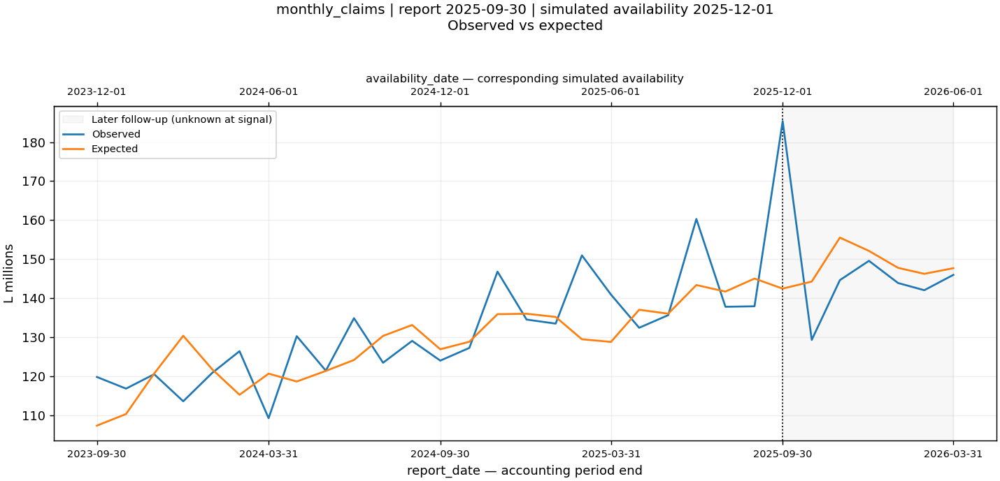
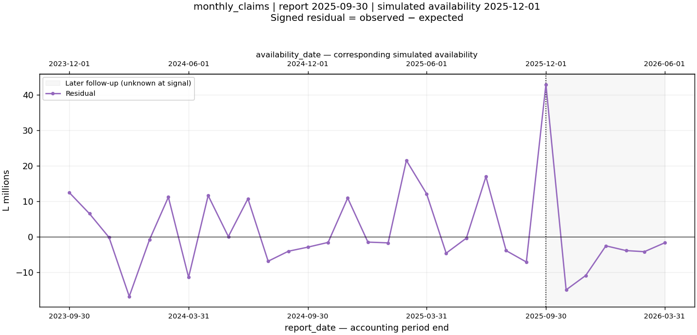
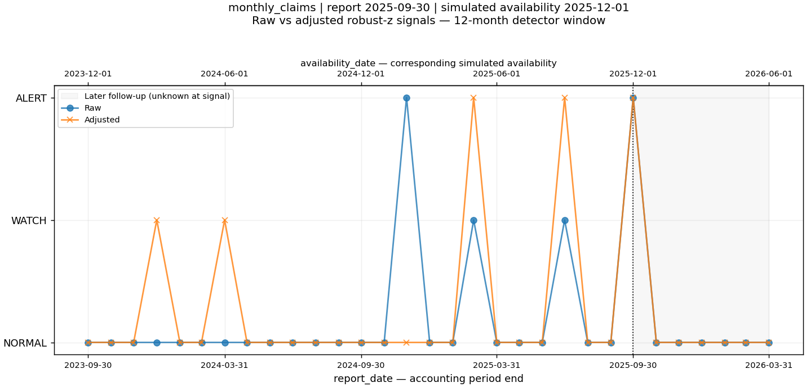
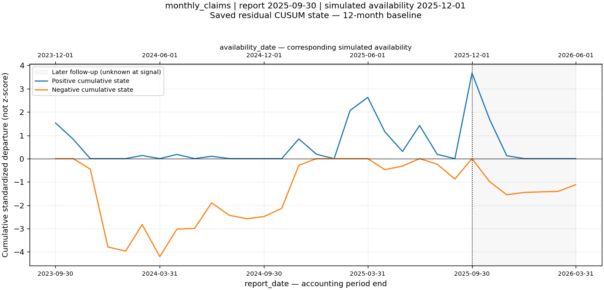

# Caso: monthly_claims del mercado — 2025-09-30

[Índice en español](case_study_index.es.md) · [Informe técnico en inglés](market_claims_2025_09.md)

## Por qué importa

Clasificación **FLAGSHIP**, idoneidad **13/18**. El caso conserva ALERT en las tres comparaciones guardadas: cohorte fija, ajuste de negativos en el entrenamiento y ventana de tendencia de 24 meses. No se eligió solo por tener un z-score grande.

## Fechas y valores

Periodo contable: **2025-09-30**. Fecha de disponibilidad simulada: **2025-12-01**. La señal solo puede observarse desde esta segunda fecha bajo el lag conservador de dos meses.

| Campo | Valor guardado |
| --- | --- |
| observed_value | 185,377,003.7 |
| expected_value | 142,434,137.5 |
| residual | 42,942,866.19 |
| relative_residual | 0.3014927949 |
| residual_signal_score | 11.01544626 |

Los importes monetarios se expresan en Lempiras.
El valor esperado es la tendencia histórica más el efecto estacional aditivo; residual = observed_value − expected_value.

## Señales estadísticas y comparación raw/ajustada

Raw: **ALERT**. Ajustada: **ALERT**. Tipo: **RAW_AND_ADJUSTED**. Ambas vistas muestran ALERT: el nivel mensual y la desviación frente a lo esperado merecen revisión.

La clasificación compara la referencia robust-z de 12 meses. Otros métodos raw pueden mostrar ALERT; no se afirma que todos hayan pasado por alto la observación.

| Método | Nivel ajustado | Score ajustado |
| --- | --- | --- |
| robust_z | ALERT | 11.01544626 |
| cusum | WATCH | 3.673215342 |
| standard_z | ALERT | 4.173215342 |

El score de CUSUM representa acumulación de desviaciones estandarizadas; no es otro z-score ni una probabilidad.

## Materialidad económica

**HIGH**. Son bandas exploratorias de percentiles de residuales anteriores. No son límites de capital, presupuesto o solvencia. Una señal estadística fuerte y un impacto financiero grande son conceptos diferentes.

## Persistencia

Secuencia consecutiva en la misma dirección conocida hasta T: robust z **1**, CUSUM **1**. Puntos por persistencia: **0/3**.

| Mes relativo | report_date | availability_date | Residual | Ajustada | Robust z | CUSUM |
| --- | --- | --- | --- | --- | --- | --- |
| -3 | 2025-06-30 | 2025-09-01 | 16,934,269.28 | ALERT | 4.436309758 | NORMAL |
| -2 | 2025-07-31 | 2025-10-01 | -3,902,951.492 | NORMAL | -0.568506554 | NORMAL |
| -1 | 2025-08-31 | 2025-11-01 | -7,108,832.53 | NORMAL | -1.533207881 | NORMAL |
| 0 | 2025-09-30 | 2025-12-01 | 42,942,866.19 | ALERT | 11.01544626 | WATCH |
| 1 | 2025-10-31 | 2026-01-01 | -14,956,834.64 | NORMAL | -1.919576348 | NORMAL |
| 2 | 2025-11-30 | 2026-02-01 | -10,907,904.39 | NORMAL | -0.7460948276 | NORMAL |
| 3 | 2025-12-31 | 2026-03-01 | -2,547,559.428 | NORMAL | -0.08598483363 | NORMAL |

Los meses T+1 a T+3 solo aportan seguimiento retrospectivo: no estaban disponibles al aparecer la señal y no suman puntos de idoneidad. Una alerta posterior en sentido contrario no confirma una subida persistente. Estos casos no acreditan un cambio sostenido solo por mostrar un pico.

## Sensibilidad a la cohorte y a negativos

Cohorte: **ROBUST**. Ajustes negativos: **UNAFFECTED**. Ventana alternativa: **ALERT**.

| Saved comparison | Status | Adjusted level | Robust z | Residual | Prior residual median |
| --- | --- | --- | --- | --- | --- |
| fixed_cohort_sensitivity | scored | ALERT | 7.599987085 | 41,978,971.52 | -495,380.3525 |
| negative_fit_sensitivity | scored | ALERT | 5.071461252 | 44,426,956.43 | -2,249,439.896 |
| trend_window_sensitivity | scored | ALERT | 9.266997352 | 46,435,691.35 | 480,256.725 |

ROBUST/UNAFFECTED significa aquí que se mantiene el nivel y dirección, con cambio del residual de hasta 25%; no significa que todos los scores sean idénticos. La cohorte fija se eligió con conocimiento de la cobertura histórica completa y es solo una sensibilidad. Los incrementos negativos se conservan y se evalúan; en la alternativa solo se excluyen del ajuste del modelo.

El robust z pasa de 11.01544626 a 5.071461252: cambio de -53.96% en su magnitud. Aunque conserve ALERT, esta diferencia muestra sensibilidad numérica de la calibración. UNAFFECTED se refiere al nivel/dirección y tolerancia del residual; no demuestra estabilidad de la línea base.

## Calidad de datos

Riesgo **MEDIUM**. quality_flags: `model_fit_review_sensitive`. source_quality_flags: `(vacío)`. composition_flags: `(vacío)`.
La revisión de datos usados para entrenar sigue siendo relevante aunque el registro actual esté limpio. Los residuales negativos no son por sí mismos ajustes contables negativos.

## Qué se puede afirmar y qué no

La observación se aparta sustancialmente del comportamiento histórico esperado y merece investigación. No demuestra fraude, desastre, insolvencia, causa ni continuidad futura del movimiento. No predice un evento histórico conocido.

Modo: **LAGGED RETROSPECTIVE BACKTEST**. Validez estricta point-in-time: **NOT VALIDATED**. Se usa el snapshot actual; las revisiones y las fechas exactas de publicación siguen sin reconstruirse.

## Preguntas para investigación externa

- ¿Cambió la frecuencia o severidad de accidentes, el costo de reparación o la cartera?
- ¿Hubo un fenómeno meteorológico inusual o un shock de mercado?
- ¿Se registró un ajuste contable, regulatorio o de reporte?
- ¿Existe una explicación oficial y desde cuándo estuvo publicada?

Son preguntas abiertas, no explicaciones demostradas.

## Uso en la demo

FLAGSHIP con las limitaciones anteriores. La idoneidad para presentar el caso no es otro score de anomalía ni una probabilidad.

