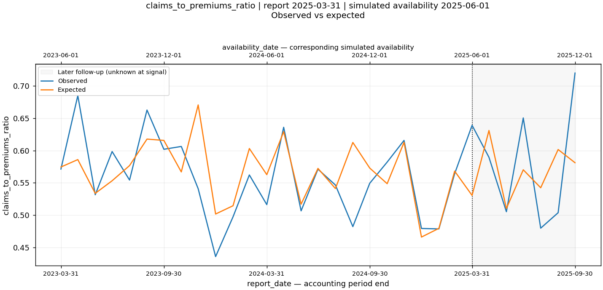
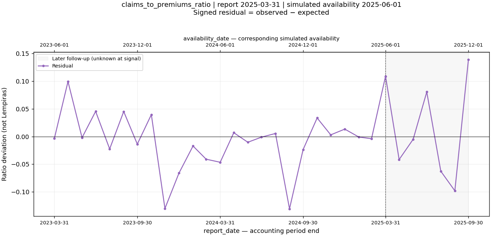
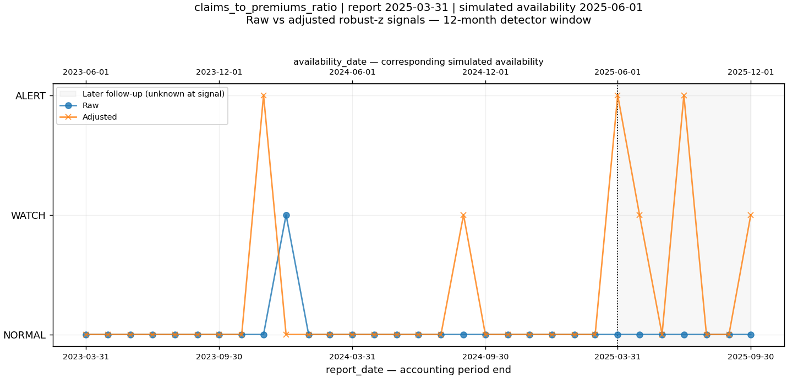
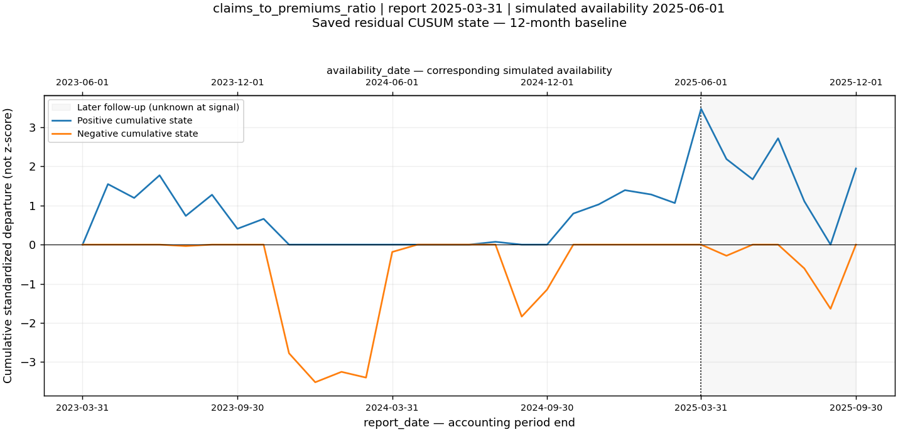

# Market: claims_to_premiums_ratio — 2025-03-31

[Case index](case_study_index.md) · [Selection methodology](../../docs/case-study-selection-methodology.md)

## Why this case matters

**FLAGSHIP**; selected shortlist: **True**. All saved market sensitivities retain direction and sufficient strength.

The ratio is about 0.6391 against 0.5305 expected: a +0.1086 departure, or 10.86 percentage points. The robust-z raw reference is NORMAL and adjusted is ALERT. All saved sensitivities retain ALERT. April reverses direction with WATCH; the later June ALERT is intermittent, not a continuous run.

## Timeline

Behavior/report period: **2025-03-31**. Simulated availability: **2025-06-01**.
The signal enters monitoring on availability_date, never on report_date. Replay mode: **LAGGED RETROSPECTIVE BACKTEST**; strict point-in-time: **NOT VALIDATED**.

## Observed vs expected

Units: dimensionless ratio; a change of 0.01 is one percentage point. Institution label at this period: Observed eligible market.

| Field | Saved value |
| --- | --- |
| observed_value | 0.6391391483 |
| expected_value | 0.5305365091 |
| residual | 0.1086026392 |
| relative_residual | 0.2047034226 |

Saved decomposition: trend_value **0.5479875467**, seasonal_effect **-0.01745103759**. Prior trend observations: **12**; prior-year same-month innovations: **6**. These are prior-available estimates, not established causal components.

Expected values use the saved trailing trend plus additive prior-year month effect. Residual = observed_value − expected_value. Figures are displayed to ten significant digits; the saved CSV retains source precision.

## Statistical signals

| Method (12-month window) | Raw | Adjusted | Adjusted score | CUSUM positive | CUSUM negative |
| --- | --- | --- | --- | --- | --- |
| robust_z | NORMAL | ALERT | 8.611067998 | not available | not available |
| cusum | NORMAL | WATCH | 3.470179214 | 3.470179214 | 0 |
| standard_z | NORMAL | WATCH | 2.907578267 | not available | not available |

CUSUM score is the signed dominant cumulative standardized departure, not a z-score or a probability. A robust z-score is not a causal diagnosis or a calibrated event probability.

## Raw vs adjusted comparison

**ADJUSTED_ONLY**. The raw robust-z reference did not produce ALERT; its adjusted reference did. This demonstrates a different historical-reference comparison, not causality.

This classification compares the 12-month robust-z reference only. Other raw methods may already alert; their levels are shown in the method table and must not be described as universally missing the observation.

## Economic materiality

**MEDIUM**. Absolute signed deviation: 0.1086026392; relative deviation: 0.2047034226.
Materiality is the existing exploratory prior-residual percentile classification, not a capital, budget or solvency threshold. Ratio deviations have no direct Lempira interpretation. A HIGH label across institution and market series does not imply equal absolute scale.

## Persistence

At signal time, same-direction consecutive non-NORMAL reference observations through T: robust z **1**, CUSUM **1**, capped by the inspected four-period backward window. Persistence points: **0/3**.

| Offset | report_date | availability_date | Context | Residual | Adjusted | Robust z | CUSUM level | CUSUM + | CUSUM − | Known at T |
| --- | --- | --- | --- | --- | --- | --- | --- | --- | --- | --- |
| -3 | 2024-12-31 | 2025-03-01 | RECORDED | 0.01330910425 | NORMAL | 0.917559189 | NORMAL | 1.391136438 | 0 | True |
| -2 | 2025-01-31 | 2025-04-01 | RECORDED | -0.0009034700726 | NORMAL | 0.2158595048 | NORMAL | 1.280800948 | 0 | True |
| -1 | 2025-02-28 | 2025-05-01 | RECORDED | -0.004023393409 | NORMAL | -0.1696822689 | NORMAL | 1.062600946 | 0 | True |
| 0 | 2025-03-31 | 2025-06-01 | RECORDED | 0.1086026392 | ALERT | 8.611067998 | WATCH | 3.470179214 | 0 | True |
| 1 | 2025-04-30 | 2025-07-01 | RECORDED | -0.041529665 | WATCH | -3.343124226 | NORMAL | 2.185704199 | -0.2844750144 | False |
| 2 | 2025-05-31 | 2025-08-01 | RECORDED | -0.004978784642 | NORMAL | -0.2241496374 | NORMAL | 1.66794791 | 0 | False |
| 3 | 2025-06-30 | 2025-09-01 | RECORDED | 0.08031674322 | ALERT | 5.260830543 | NORMAL | 2.716187151 | 0 | False |

T+1 through T+3 are retrospective follow-up only. They do not affect suitability points, the original signal or decision-time persistence. Opposite-direction alerts are not a persistent same-direction shift. Missing/censored rows remain explicit. CUSUM's non-NORMAL state alone is not proof that subsequent raw values remain elevated.

## Cohort sensitivity

**ROBUST**. Saved alternative=ALERT; score=4.96114; relative residual change=8.68%.
The fixed complete-history roster was selected with hindsight and is a sensitivity comparison, not an independently point-in-time-valid primary result.

## Negative-adjustment sensitivity

**UNAFFECTED**. Saved alternative=ALERT; score=4.46646; relative residual change=11.16%.
No negative-sensitive source observation occurs within T−3 through T−1. Negative residuals are deviations from expectation; they are not automatically negative accounting increments. “UNAFFECTED” is an operational suitability label: it does not require identical fitted scores.

Robust z changes from 8.611067998 to 4.466455806: -48.13% in score magnitude. Even if ALERT survives, this difference shows numerical calibration sensitivity. UNAFFECTED describes the signal-level/direction and residual-tolerance rule, not stability of the fitted residual baseline.

## Window sensitivity

Saved 24-month trend alternative adjusted level: **ALERT**. The detector reference stays robust z with a 12-month detector window. Missing institution counterfactuals are unassessed, not passed.

| Saved comparison | Status | Adjusted level | Robust z | Residual | Prior residual median |
| --- | --- | --- | --- | --- | --- |
| fixed_cohort_sensitivity | scored | ALERT | 4.961135798 | 0.09917828537 | -0.005848109592 |
| negative_fit_sensitivity | scored | ALERT | 4.466455806 | 0.1207186457 | 0.007196714227 |
| trend_window_sensitivity | scored | ALERT | 5.8281316 | 0.08362457138 | -0.008358367777 |

## Data-quality considerations

Risk: **MEDIUM**. Direct negative-sensitive observation: **False**.

| Source/model field | Recorded value |
| --- | --- |
| quality_flags | model_fit_review_sensitive |
| source_quality_flags | (empty) |
| composition_flags | (empty) |
| source_derivation_status | derived_consecutive_month |
| negative_review_sensitive | False |
| trend_training_negative_count | 0 |
| trend_training_review_count | 1 |
| seasonal_training_review_count | 0 |
| contributing_institutions | (empty) |
| excluded_institutions | (empty) |
| review_flagged_institutions | (empty) |
| blocked_contributors | (empty) |
| negative_contributors | (empty) |
| contributor_codes | (empty) |
| excluded_codes | (empty) |
| entered_codes | (empty) |
| exited_codes | (empty) |
| premium_contributing_institutions | 11 |
| claims_contributing_institutions | 11 |
| premium_excluded_institutions | 0 |
| claims_excluded_institutions | 0 |
| premium_review_flagged_institutions | 0 |
| claims_review_flagged_institutions | 0 |
| premium_blocked_contributors | 0 |
| claims_blocked_contributors | 0 |
| premium_negative_contributors | 0 |
| claims_negative_contributors | 0 |

Institution label history available through the signal (first observation or observed label change, not a verified legal transition):

| First report with label | Institution label |
| --- | --- |
| 2018-01-31 | Observed eligible market |

Institutions are separated by code; names do not establish legal continuity. Existing source and model-training review flags are retained. A clean current row does not erase flagged fitting history. A missing institution is never treated as zero.

## What the system can claim

This observation differs substantially from expected historical behavior under the saved lagged retrospective design and deserves investigation. Raw magnitude, residual statistics and exploratory materiality are separate evidence.

## What the system cannot claim

The signal establishes neither fraud, disaster, insolvency, causality nor continued claims growth. It does not predict a known historical event or establish strict point-in-time or production performance. The ratio is claims_to_premiums_ratio, not a validated actuarial loss ratio. Historical revisions and exact release dates remain unresolved.

## Questions for external investigation

- Did accident frequency, claim severity, repair prices or portfolio mix change?
- Was there an unusual weather event or a broader market shock?
- Was a regulatory, reporting, reserving or accounting adjustment recorded?
- Do official publications or the institution explain the movement, and when was that evidence public?

These are unanswered investigation prompts. No external event was used to select or inflate this case.

## Demo suitability

**12/18 — FLAGSHIP**. Selected: **True**.

| Suitability dimension | Points / 3 |
| --- | --- |
| statistical_robustness | 2 |
| economic_materiality | 2 |
| persistence | 0 |
| sensitivity_robustness | 3 |
| data_quality_confidence | 2 |
| narrative_usefulness | 3 |

This is a transparent presentation-selection rubric, not another anomaly score, a probability or a validation label. Selection is exploratory and conditioned on this current snapshot.

